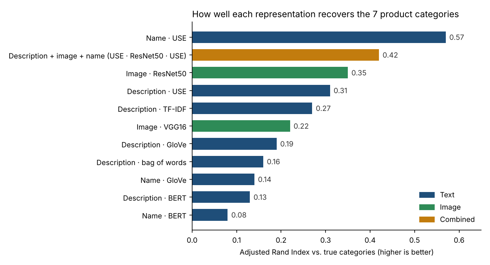

# Automatic product categorisation from text and images: feasibility study

[](https://github.com/Yassaadi/NLP_CV/actions/workflows/ci.yml)

> Re-implementation on public data of an approach I delivered in a freelance engagement. Client data and code are confidential and not included; this version uses a public Flipkart product sample (1,050 products, 7 categories).

## The problem

A marketplace's sellers assign product categories by hand, which is slow and error-prone. Before building a classifier, the business wanted to know: **do product names, descriptions and photos carry enough signal to group products into their categories automatically?**

## Approach

Each product is turned into a numeric representation, clustered with k-means (k = 7 categories), and the clusters are compared with the real categories using the **Adjusted Rand Index** (ARI: 0 = random grouping, 1 = perfect match). No labels are used to build the features, so a good ARI means a supervised model will have strong signal to learn from.

| Modality | Representations compared |
|---|---|
| Text (name and description) | Bag of words, TF-IDF, GloVe, BERT (`[CLS]` embedding), Universal Sentence Encoder (USE) |
| Image | SIFT bag of visual words (explored), VGG16 and ResNet50 (ImageNet, transfer learning) |
| Combined | Every text × image × name combination |

Text was cleaned (lower-casing, URL and punctuation removal, stop words, lemmatisation) before the classical methods; transformer models received raw text with their own tokenisers.

## Results



- **Feasibility confirmed.** The best single signal, the **product name embedded with USE**, reaches an ARI of **0.57** without any training on labels.
- **Images help on their own.** ResNet50 features (0.35) clearly beat VGG16 (0.22).
- **Sentence-level models win on short texts.** USE beats BERT `[CLS]` embeddings, which are not trained to be used directly as sentence vectors.
- **GloVe is understated.** The original run averaged character vectors instead of word vectors (a tokenisation bug, now fixed in the notebook), so its scores are a lower bound.
- **Naive fusion underperformed.** The best combination (0.42) stayed below names alone, because raw concatenation lets the 100,000-dimension image vectors dominate. `src/benchmark.py` fixes this by reducing each modality to the same size before combining.

**Recommendation:** go ahead with a supervised classifier using USE name embeddings plus ResNet50 image features, with a balanced fusion of the two.

## Repository

```
notebooks/product_clustering_feasibility.ipynb   full study: preprocessing, feature extraction, clustering, evaluation
src/benchmark.py                                  reusable benchmark: reduce, combine modalities, k-means, ARI
tests/                                            unit tests run in CI
```

```bash
pip install -r requirements.txt
pytest                      # benchmark tests
jupyter lab notebooks/      # data expected in data/ (product CSV and images/)
```

## Next steps

- Train a supervised classifier (logistic regression or a small MLP on the embeddings) and report per-category precision and recall
- Fine-tune a multilingual sentence model on catalogue text
- Replace VGG/ResNet with a joint image-text model (CLIP) and compare fusion strategies
